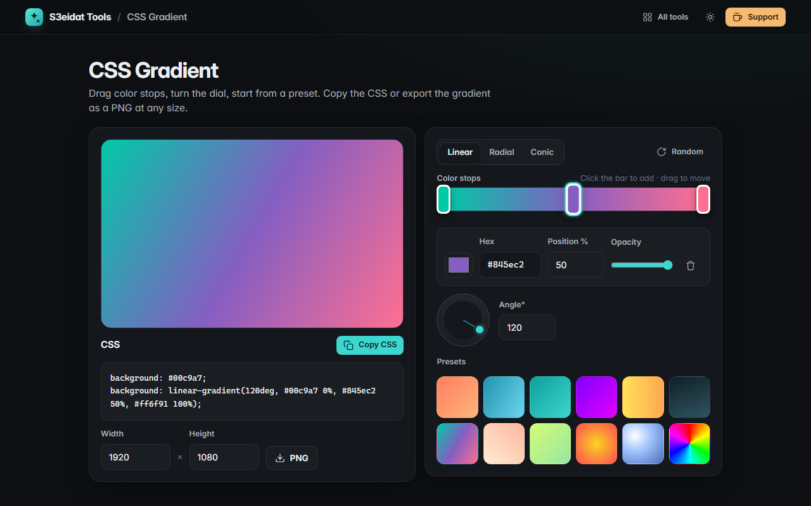

# CSS Gradient

> Build beautiful linear, radial and conic CSS gradients visually. Free, private, and it runs entirely in your browser.

### ▶ [Open CSS Gradient](https://s3eidat.github.io/css-gradient/)



## Features

- **Linear, radial and conic** gradients with a big live preview
- **Draggable color stops** on a bar: click to add (the color is interpolated), drag or use arrow keys to move, Delete to remove
- Per-stop **color, hex, position and opacity**
- **Angle dial** (hold Shift to snap to 15°), radial **circle / ellipse**, and center position for radial and conic
- **12 presets** and a **Random** button that picks harmonious colors
- **Copy CSS** (with a solid-color fallback line)
- **Export PNG** at any size up to 8000 × 8000, drawn locally on a canvas using the same geometry as CSS
- Remembers your last gradient

## Privacy

Nothing you make leaves your device. There is no server, no account, no analytics.
The page ships with a strict Content-Security-Policy (`connect-src 'self'`), so the browser
itself blocks any attempt to send data anywhere.

## Run it yourself

It's plain HTML, CSS and JavaScript with no build step:

```bash
git clone https://github.com/s3eidat/css-gradient
cd css-gradient
python -m http.server 8000
```

Then open http://localhost:8000.

## Support

If this saved you time, **[buy me a coffee ☕](https://s3eidat.github.io/coffee/)**. It keeps every tool free.

---

Part of **[S3eidat Tools](https://s3eidat.github.io/)**: 100+ free, private tools that run in your browser. MIT licensed.
